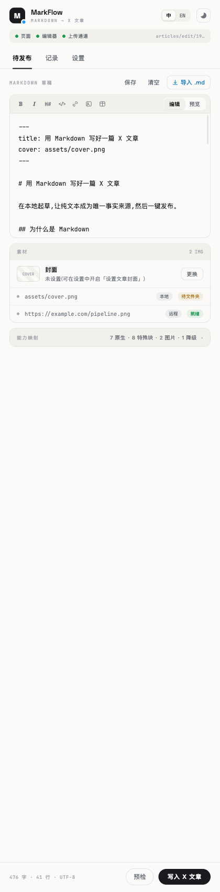
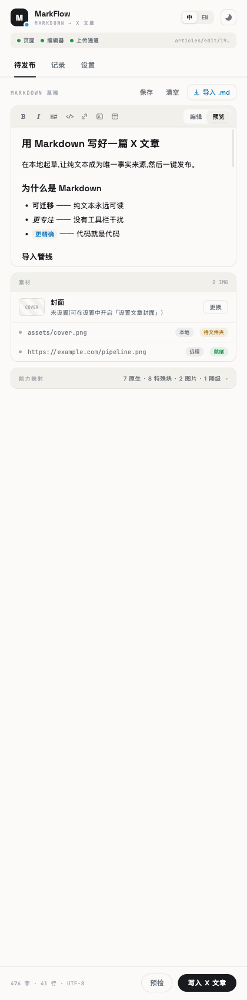
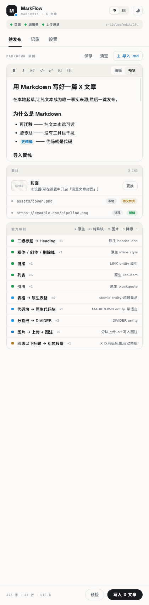
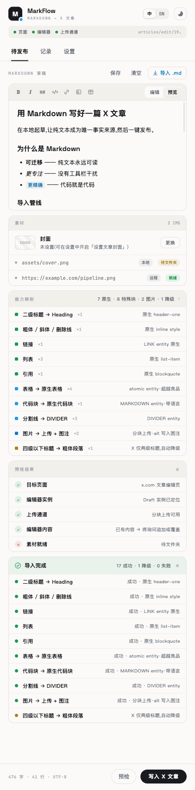
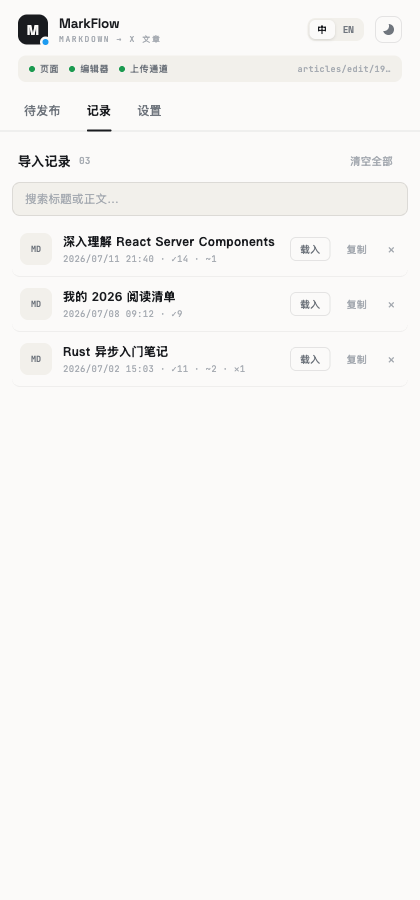
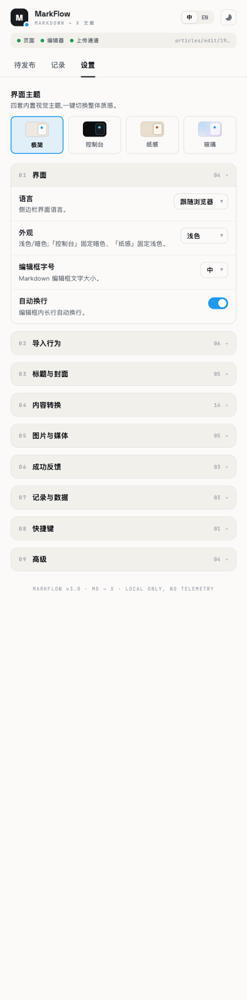
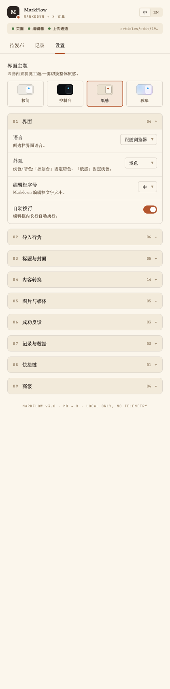

# MarkFlow · X 文章 Markdown 导入器

> 把 Markdown 一键导入 **X（Twitter）Articles 长文编辑器**，全格式自动排版——标题、粗体 / 斜体 / 删除线、链接、列表、引用、**原生代码块、原生表格、图片、封面、分割线、推文嵌入**。不使用官方付费 API，纯浏览器层完成；本地优先，无遥测，**永不自动发布**。

Chrome 扩展（Manifest V3）· WXT + React 18 + TypeScript · 侧边栏工作台。

---

## 界面预览

侧边栏工作台 —— 编辑、实时预览、写入前的「能力映射」：

<table>
  <tr>
    <td width="33%"></td>
    <td width="33%"></td>
    <td width="33%"></td>
  </tr>
  <tr>
    <td align="center"><sub>Markdown 编辑</sub></td>
    <td align="center"><sub>实时预览</sub></td>
    <td align="center"><sub>能力映射：写入前告知每个元素会变成什么</sub></td>
  </tr>
</table>

导入报告、历史记录、诚实的设置面板：

<table>
  <tr>
    <td width="33%"></td>
    <td width="33%"></td>
    <td width="33%"></td>
  </tr>
  <tr>
    <td align="center"><sub>导入报告（逐项成功 / 降级 / 失败）</sub></td>
    <td align="center"><sub>历史记录（搜索 / 载入 / 重导）</sub></td>
    <td align="center"><sub>设置面板（每个开关都真实生效）</sub></td>
  </tr>
</table>

四套界面主题（各分明暗，一键切换）：

<table>
  <tr>
    <td width="25%"></td>
    <td width="25%"></td>
    <td width="25%"></td>
    <td width="25%"></td>
  </tr>
  <tr>
    <td align="center"><sub>极简 Minimal</sub></td>
    <td align="center"><sub>控制台 Console</sub></td>
    <td align="center"><sub>纸感 Paper</sub></td>
    <td align="center"><sub>玻璃 Glass</sub></td>
  </tr>
</table>

<sub>截图为侧边栏各视图（极简主题·中文）；界面持续演进，以实际运行为准。</sub>

---

## 功能

**写入 X 文章正文**（借 Draft.js 直写，非合成粘贴）：标题（H1/H2）、粗体 / 斜体 / 删除线、链接、有序 / 无序列表、引用、**原生代码块**（X 的 `MARKDOWN` entity，带语言标注）、**原生表格**（GFM，X 直接渲染而非转图片）、分割线、**推文嵌入**（独占行 X/Twitter 链接 → 卡片）；行内代码 X 正文不支持、降级为保留反引号纯文本。支持整体覆盖 / 追加两种写入模式。

**图片上传**：独占一行的图片自动上传到 X——
- **远程** ``：后台 service worker 代理下载（SSRF 防护 + 体积上限 + magic-byte 真实类型嗅探）；
- **dataURI** ``：就地解析；
- **本地相对路径** `` 与 **Obsidian 内嵌** `![[x.png]]`：经 File System Access 从授权文件夹读取；
- 可选 **图片压缩**（>150KB 时 canvas 等比缩放 + JPEG 重编码，长边 / 质量可调，压完更大自动退回原图）。

**本地图按需授权**：素材面板「本篇图片文件夹」+ 设置里的默认文件夹，两级、逐文件兜底（本篇找不到再退默认）；浏览器重启导致读权限回落后，**一键恢复**上次文件夹、免重新选择。

**标题与封面**：frontmatter `title` / 正文首个 H1 → 自动设为文章标题；frontmatter `cover` / 正文首图 → 设为文章封面。

**能力映射预览** ⭐：写入前逐项告知每个 Markdown 元素会变成什么（原生 / 特殊块 / 图片 / 降级），不会「导入完才发现表格丢了」。

**预检探针（自动重探）**：写入前检查目标页 / 编辑器实例 / 上传通道三灯是否就绪；切换标签、刷新页面、SPA 切换文章后**自动重探**连接状态，免手动点刷新。

**导入报告 + 历史记录**：逐项成功 / 降级 / 失败清单；历史记录可搜索、载入、复制、重导。

**诚实的设置面板**：界面、导入行为、标题封面、内容转换、图片媒体、成功反馈等分组——**每个开关都真实生效**；平台限制下做不到或暂不做的项已直接移除，尚未接入的明确置灰并标注，绝不给假选项。

**其它**：四套界面主题（极简 / 控制台 / 纸感 / 玻璃，各分明暗，一键切换）· 中英双语 · 本地优先、无遥测 · **永不自动发布**（发布按钮永远留给用户）。

> **状态（v0.2.0）**：核心链路已全线打通并真机验证——正文（含代码块 / 表格 / 图片 / 封面 / 推文 / 分割线）真实写入 X 编辑器，本地图按需授权、图片压缩、探针自动重探、标题冲突询问均已落地，设置面板完成「诚实化」整顿，并做过发布前 4 专项审计加固。演进细节见 [CHANGELOG.md](./CHANGELOG.md)，进度与规划见 [HANDOFF.md](./HANDOFF.md)。

## 快速开始

前置：Node ≥ 20、pnpm、Google Chrome。

```bash
pnpm install          # 首次安装会构建 esbuild（已在 pnpm-workspace.yaml 放行）
pnpm dev              # WXT 开发模式（HMR）
pnpm build            # 生产构建 → .output/chrome-mv3
pnpm compile          # 仅类型检查（tsc --noEmit）
```

加载扩展：Chrome → `chrome://extensions` → 打开「开发者模式」→「加载已解压的扩展程序」→ 选择 `.output/chrome-mv3`，点击工具栏图标即打开侧边栏。

> 不想本地构建？到 [Releases](../../releases) 下载打包好的 `x-md-importer-<版本>-chrome.zip`，解压后同样用「加载已解压的扩展程序」选解压目录即可。

**真机使用注入功能**：需登录 X 并打开文章编辑页（`x.com/compose/articles/edit/…`）。**改动 content/injector 后务必刷新 X 页面**——扩展更新不会自动替换页面里已注入的旧脚本（面板会提示「请刷新此 X 页面」）。

**纯 UI 预览**（无需装扩展、测不了注入）：`pnpm build` 后用任意静态服务器托管 `.output/chrome-mv3`，浏览器打开 `sidepanel.html`（chrome.storage 不可用时自动回退 localStorage），窗口宽度调到约 404px 模拟侧边栏。

## 技术栈

| 方面 | 选择 |
|---|---|
| 扩展框架 | [WXT](https://wxt.dev)（MV3，多 world content script、injectScript、HMR） |
| UI | React 18 + TypeScript（函数组件，无 class） |
| Markdown | 自研递归下降解析器（写入用，精确产出 Draft 块 + 行内样式区间）；react-markdown + remark-gfm 仅用于编辑器内预览 |
| 注入 | MAIN world 经 React fiber 借页面 Draft.js / Immutable 构造器直写 blockMap（比合成 paste 更稳） |
| 主题 | CSS 变量驱动（四套主题 = 同一变量表的多组取值） |
| 图片 | 远程走 background service worker 代理 + SSRF 防护；本地走 File System Access；压缩走 canvas |
| 字体 | @fontsource 本地打包（Space Grotesk / JetBrains Mono；CJK 用系统字体栈） |
| 持久化 | chrome.storage.local（非扩展环境回退 localStorage）；本地图句柄存 x.com IndexedDB |
| 包管理 | pnpm |

## 目录结构

```
x-md-importer/
├── entrypoints/
│   ├── background.ts              # MV3 service worker（开侧边栏 + 远程图代理下载）
│   ├── content.ts                 # ISOLATED world：注入 injector + 握手 + 请求桥 + 图片准备/压缩 + 本地文件夹
│   ├── injector.ts                # MAIN world：fiber 探针 + Draft 直写引擎 + 标题/封面/图片上传
│   └── sidepanel/                 # 侧边栏 React 应用（main.tsx / App.tsx / styles / components）
├── lib/
│   ├── markdown/                  # parser（Markdown → 写入块）+ frontmatter 抽取 + 能力映射 + 预览
│   ├── image/                     # compress.ts（canvas 缩放 + JPEG 压缩）
│   ├── bridge/                    # 三方通信协议 + 探针(useProbe) + 写入入口 + tab 定位 + 本地图 localVault
│   ├── workspace/                 # WorkspaceProvider（草稿 / 记录 + 真实导入流程）
│   ├── settings/                  # Options 模型 + SettingsProvider + 分组配置
│   ├── theme/ i18n/ prefs/ storage/   # 主题 / 中英字典 / 偏好 / 持久化切片
├── docs/                          # 技术方案设计、调研报告（xPoster 源码分析）、M0 探针产物、QA 对照
├── CHANGELOG.md                   # 版本变更记录
└── HANDOFF.md                     # 跨机器接力文档（上下文 / 进度 / 待办 / 踩坑）
```

## 文档

- [HANDOFF.md](./HANDOFF.md) — **跨机器接力文档**（上下文、进度、待办、已知陷阱与规划），每次提交前更新。
- [CHANGELOG.md](./CHANGELOG.md) — 版本变更记录。
- [docs/技术方案设计.md](./docs/技术方案设计.md) — 产品功能规格与注入引擎方案（事实基座）。
- [docs/research/](./docs/research/) — 调研报告（xPoster 源码分析等）与 M0 探针产物。

## 许可

私有项目，暂未开源。
